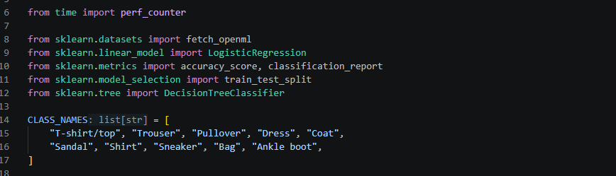
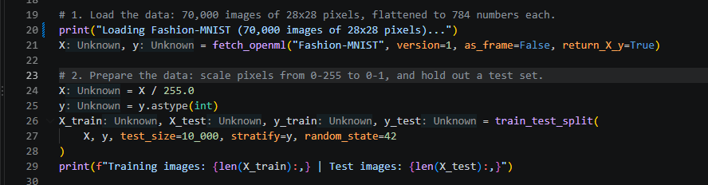
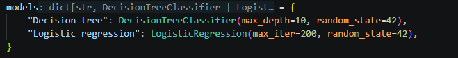
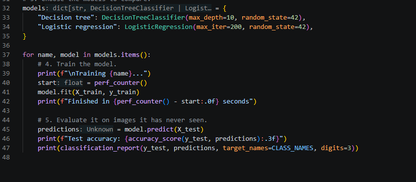
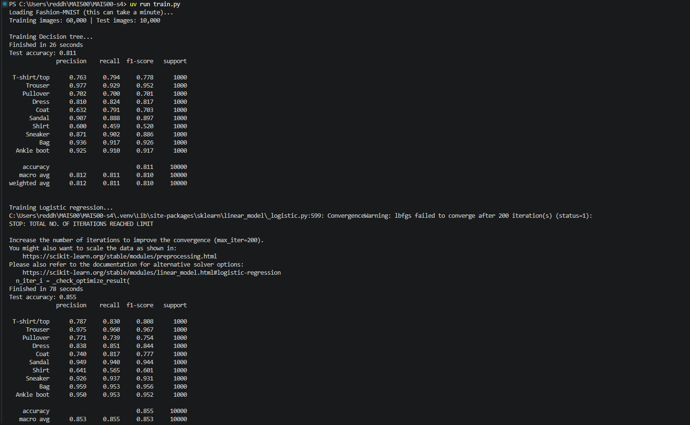

# Overview
This is a uni week 4 task for unit MAI500 Emerging Topics in Artificial Intelligence
The document is converted to .md from the submitted .docx format
I used two supervised learning models to classify images of clothes into 10 categories.

# Details

1.  The environment: I used my own desktop which had an MX250 GPU with ~1.6GB of VRAM, I decided to run it on my CPU instead using Windows. I used uv package manager for my package dependencies and requirements.

2.  The dataset: I used the Fashion-MNIST dataset I downloaded with Scikit-Learn. It has 70,000 greyscale images of different types of clothing.

3.  Data preparation: I split the dataset into 60,000 for training and 10,000 for testing. The split is random but repeatable to keep the classes balanced.

4.  Model selection: I used a Decision tree model, max depth of 10 and a Logistic regression model, max iteration of 200 to see which one had more accurate results. These values were picked at random

5.  Training: Each image is stored as 784 numbers considering one per pixel to correspond to 70,000 images of 28x28 pixels. The pixel values were divided by 255 to change their range from 0-255 to 0-1

6.  Results:

Overall, it took 29 seconds to train using decision tree model and about 75 seconds to train using logistic regression model. It took a while to load the dataset in the beginning. It seems like logistic regression shows an 85.5% test accuracy compared to the decision tree which is only 81.1%. The above image shows the 10 classifications of the clothing, namely T-shirt/top, Trouser, Pullover, Dress, Coat, Sandal, Shirt, Sneaker, Bag and Ankle boot.

7.  Challenges: I ran into an issue while downloading and syncing my packages due to Window’s long-path support being off, which happened because I my folder path was longer than 262 allowed characters which I resolved by shortening the path.

> The code is publicly available at <https://github.com/Red-dish/MAI500-s4>
